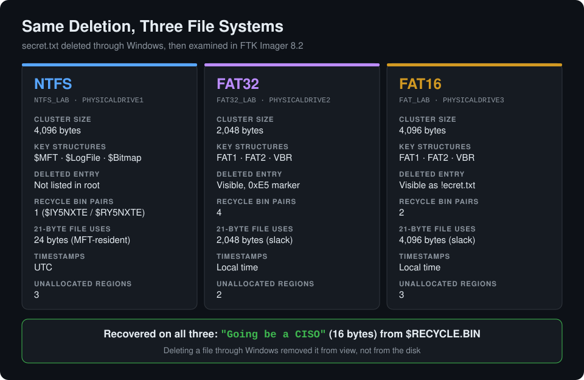
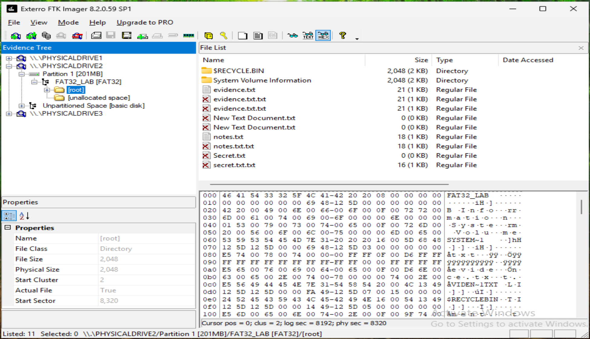
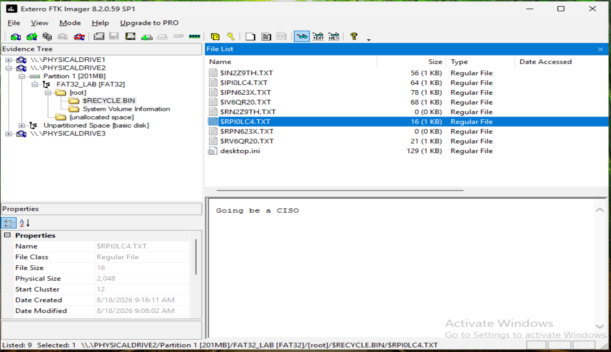
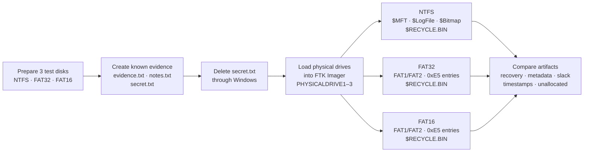

# Windows File System Forensics: NTFS, FAT32 & FAT16 with FTK Imager


A hands-on **digital forensics lab** that runs the same controlled deletion on three Windows file systems and examines what each one leaves behind. I built three test disks (**NTFS**, **FAT32** and **FAT16**), created known evidence files, deleted `secret.txt` through Windows, then loaded all three physical drives into **Exterro FTK Imager** to examine file-system structures, active and deleted files, Recycle Bin artifacts, hex data and unallocated space.

> **Result:** the "deleted" file was recovered intact on **all three** file systems. Its exact content (`Going be a CISO`, 16 bytes) sat in the `$RECYCLE.BIN` of every volume. What differed was the surrounding evidence: NTFS kept rich metadata structures, while FAT32 and FAT16 kept visible deleted directory entries marked with `0xE5`.



## Why I Did This

"Deleted" is one of the most misunderstood words in an investigation. I wanted to see the gap between what a user believes happened and what the disk actually records, and how that changes with the file system. Building the evidence myself meant every file name, size and line of content was known in advance, so each recovery could be confirmed positively rather than assumed. Running the identical scenario on NTFS, FAT32 and FAT16 turned three separate examinations into a direct comparison.

## Highlights

- **Controlled evidence:** three dedicated test disks with known files: `evidence.txt` (`My name is Anik Nohan`, 21 bytes), `notes.txt` (18 bytes) and `secret.txt` (`Going be a CISO`, 16 bytes).
- **Physical-drive acquisition view:** each disk loaded into FTK Imager 8.2.0.59 SP1 as `\\.\PHYSICALDRIVE1–3`, not just as files.
- **Deleted-file recovery on 3 of 3 file systems:** the original content recovered from the Recycle Bin `$R` file on NTFS, FAT32 and FAT16.
- **Recycle Bin artifact analysis:** `$I` metadata and `$R` content pairs identified on every volume (1 on NTFS, 4 on FAT32, 2 on FAT16).
- **NTFS internals:** `$MFT` (`FILE0` signature), `$LogFile` (`RSTR` restart area) and `$Bitmap` (allocated `FF` vs free `00` clusters) inspected at hex level.
- **FAT deletion mechanics:** deleted directory entries marked with `0xE5`, which turned the deleted name into `!ecret.txt` on FAT16.
- **Storage behaviour:** a 21-byte file used 24 bytes on NTFS (consistent with MFT-resident data) but a whole 2,048- or 4,096-byte cluster on FAT, leaving file slack.
- **Timestamp awareness:** NTFS times appeared in UTC (four hours ahead of Explorer), while FAT32 and FAT16 stored local time.
- **Unallocated space:** 3, 2 and 3 unallocated regions mapped on NTFS, FAT32 and FAT16.

## Screenshots

| NTFS: deleted file recovered from `$RECYCLE.BIN` | NTFS: `$MFT` record in hex (`FILE0`) |
|---|---|
|  |  |

| FAT32: deleted entries and `0xE5` markers | FAT32: deleted file recovered |
|---|---|
|  |  |

| FAT16: deleted entry shown as `!ecret.txt` | All three drives loaded in FTK Imager |
|---|---|
|  |  |

All 27 screenshots are embedded, phase by phase, in the [project documentation](#project-documentation).

## Tools & Technologies

- **Exterro FTK Imager 8.2.0.59 SP1:** physical-drive examination, file-system parsing, text and hex viewing, unallocated-space review.
- **Windows Disk Management:** creating, partitioning and formatting the three test disks.
- **Windows File Explorer:** creating and deleting the controlled evidence files.
- **Notepad:** writing the known text content.
- **Windows 11:** lab operating environment.

## Investigation Flow



## Investigation Workflow

1. **Prepare three test disks** in Windows Disk Management, one each for NTFS (`NTFS_LAB`), FAT32 (`FAT32_LAB`) and FAT16 (`FAT_LAB`).
2. **Create known evidence** with recognizable content and sizes recorded in advance.
3. **Delete `secret.txt`** through Windows, then confirm it no longer appears in File Explorer.
4. **Load each disk into FTK Imager** as a `Physical Drive` evidence source.
5. **Identify the file-system structure** of each volume (cluster size, metadata files, FAT tables).
6. **Examine active files** and confirm their known content and metadata.
7. **Locate deleted artifacts** in the directory listings and `$RECYCLE.BIN`.
8. **Inspect hex data** of key structures and directory entries.
9. **Map unallocated space** on each volume.
10. **Compare results** across the three file systems.

## Comparison of Findings

| Observation | NTFS | FAT32 | FAT16 |
|---|---|---|---|
| Cluster size | 4,096 bytes | 2,048 bytes | 4,096 bytes |
| Key structures | `$MFT`, `$LogFile`, `$Bitmap` | `FAT1`, `FAT2`, `VBR` | `FAT1`, `FAT2`, `VBR` |
| Deleted entry in root | Not listed | Visible, `0xE5` marker | Visible as `!ecret.txt` |
| Recycle Bin `$I`/`$R` pairs | 1 | 4 | 2 |
| Recovered `secret.txt` | `$RY5NXTE.txt` | `$RPI0LC4.TXT` | `$RLXOD2W.TXT` |
| Space used by 21-byte file | 24 bytes | 2,048 bytes | 4,096 bytes |
| Timestamps | UTC | Local | Local |
| Unallocated regions | 3 | 2 | 3 |

Full detail in the [File-System Forensic Comparison](docs/07-file-system-forensic-comparison.md).

## Key Findings

1. **Deletion is not destruction.** On every file system, the deleted file's exact content survived in `$RECYCLE.BIN` as a `$R` file, with a matching `$I` metadata file.
2. **NTFS records the most context.** The `$MFT`, `$LogFile` and `$Bitmap` structures give an examiner file records, a change log and cluster allocation state, beyond the file content itself.
3. **FAT keeps deleted entries in plain sight.** FAT32 and FAT16 left deleted directory entries visible, marked with `0xE5`. On FAT16 this destroyed the first character of the name, which FTK Imager showed as `!ecret.txt`.
4. **Cluster size creates slack.** A 21-byte file took a whole cluster on FAT (2,048 or 4,096 bytes) but only 24 bytes on NTFS, consistent with small-file data stored resident in the MFT.
5. **Timestamps need normalizing.** NTFS times were UTC and FAT times were local, so a cross-volume timeline must convert them before comparing.
6. **Unallocated space is a residual-data source.** Every volume had unallocated regions where data from deleted files can persist until overwritten.

## Repository Structure

```text
windows-file-system-forensics-ftk-imager-lab/
├── README.md
├── LICENSE
├── assets/
│   └── diagrams/
│       └── file-system-comparison.svg     # side-by-side results diagram
├── docs/                                  # one document per lab phase
│   ├── 01-evidence-creation.md
│   ├── 02-controlled-file-deletion.md
│   ├── 03-ftk-imager-evidence-loading.md
│   ├── 04-ntfs-forensic-analysis.md
│   ├── 05-fat32-forensic-analysis.md
│   ├── 06-fat16-forensic-analysis.md
│   └── 07-file-system-forensic-comparison.md
└── evidence/
    └── screenshots/                       # 27 screenshots, one folder per phase
        ├── 01-evidence-creation/
        ├── 02-controlled-file-deletion/
        ├── 03-ftk-imager-evidence-loading/
        ├── 04-ntfs-forensic-analysis/
        ├── 05-fat32-forensic-analysis/
        └── 06-fat16-forensic-analysis/
```

## Project Documentation

| Phase | Document | What it covers |
|---|---|---|
| 01 | [Evidence Creation](docs/01-evidence-creation.md) | Test volumes, known files and their content |
| 02 | [Controlled File Deletion](docs/02-controlled-file-deletion.md) | Deleting `secret.txt` and the result in Windows |
| 03 | [FTK Imager Evidence Loading](docs/03-ftk-imager-evidence-loading.md) | Loading `PHYSICALDRIVE1–3` as evidence sources |
| 04 | [NTFS Forensic Analysis](docs/04-ntfs-forensic-analysis.md) | `$MFT`, `$LogFile`, `$Bitmap`, Recycle Bin recovery, unallocated space |
| 05 | [FAT32 Forensic Analysis](docs/05-fat32-forensic-analysis.md) | FAT structure, `0xE5` entries, Recycle Bin recovery, slack |
| 06 | [FAT16 Forensic Analysis](docs/06-fat16-forensic-analysis.md) | `!ecret.txt` artifact, Recycle Bin recovery, unallocated space |
| 07 | [File-System Forensic Comparison](docs/07-file-system-forensic-comparison.md) | Side-by-side measured results and conclusions |

## How to Review

1. **Start with the diagram and comparison table** above for the results at a glance.
2. **Follow one file system end to end:** [NTFS](docs/04-ntfs-forensic-analysis.md) shows the richest artifacts; [FAT16](docs/06-fat16-forensic-analysis.md) shows the `0xE5` deletion marker most clearly.
3. **Check the recovery yourself:** compare the known content in [Evidence Creation](docs/01-evidence-creation.md) with the recovered `$R` files in each analysis document.
4. **Read the comparison:** [File-System Forensic Comparison](docs/07-file-system-forensic-comparison.md) ties the three examinations together.

## Skills Demonstrated

- **File-system forensics:** NTFS, FAT32 and FAT16 structure, allocation and deletion behaviour.
- **Deleted-file recovery:** locating and confirming deleted content against known ground truth.
- **Windows artifact analysis:** `$RECYCLE.BIN` `$I`/`$R` pairs and per-user SID folders.
- **NTFS metadata analysis:** `$MFT`, `$LogFile`, `$Bitmap` and resident data.
- **Hex-level examination:** reading file signatures and the FAT `0xE5` deletion marker.
- **Storage analysis:** cluster sizes, file slack and unallocated space.
- **Timeline awareness:** UTC vs local-time storage across file systems.
- **FTK Imager:** physical-drive evidence loading, tree navigation, text and hex views.
- **Forensic methodology:** controlled baseline, repeatable workflow and evidence-backed documentation.

## Roadmap

- Create forensic images (E01/raw) of each disk and verify them with MD5/SHA-1 hashes
- Parse the `$I` files to extract the original path and deletion timestamp
- Carve deleted content directly from unallocated space
- Add exFAT and ReFS to the comparison
- Repeat the scenario with Shift+Delete (bypassing the Recycle Bin) and with secure deletion

---

## Disclaimer

This project was performed entirely in a controlled lab environment for educational and portfolio purposes. All disks, files and deletion activity were created specifically for forensic analysis. The disks were examined directly as physical drives rather than through hashed forensic images, which is acceptable for a lab but not for casework. No real-world systems or third-party data were involved.

---

## Author

**Anik Nohan**

This lab was built to practise and demonstrate real-world digital forensics skills in:

- Windows file-system forensics (NTFS, FAT32, FAT16)
- Deleted-file investigation and recovery
- Recycle Bin and NTFS metadata artifact analysis
- Hexadecimal evidence inspection
- Unallocated-space and file-slack analysis
- Comparative forensic analysis and documentation

Also see my **[Windows DFIR Security Event Investigation](https://github.com/aniknohan/windows-dfir-security-event-investigation)**, **[Splunk SOC Analyst Detection Lab](https://github.com/aniknohan/splunk-soc-analyst-detection-lab)** and **[Report Writing Using Phishing Tools](https://github.com/aniknohan/report-writing-using-phishing-tools)**.

### Tools Used

`Exterro FTK Imager` • `Windows Disk Management` • `Windows File Explorer` • `Notepad` • `Windows 11`

## License

Released under the [MIT License](LICENSE).
