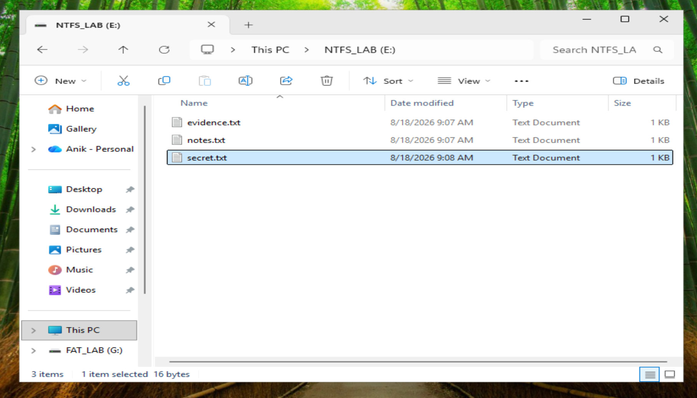
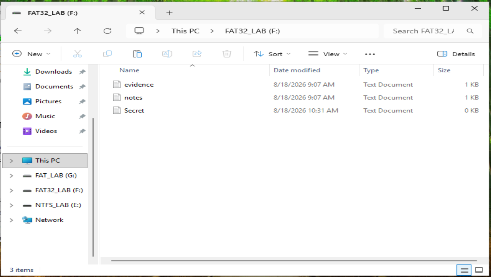
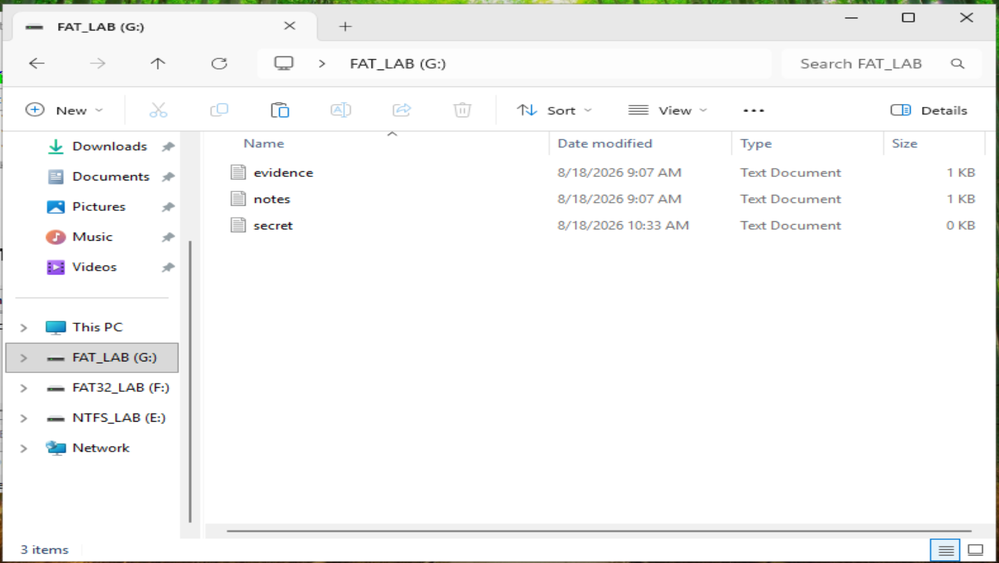

# Evidence File Creation

## Objective

The first phase of this lab involved creating controlled text files that would later be examined using Exterro FTK Imager.

The purpose was to create known evidence, perform controlled file deletion, and then compare how the resulting artifacts appeared across NTFS, FAT32, and FAT16 file systems.

---

## Test File Systems

Three separate test volumes were used during the lab:

| Volume | File System |
|---|---|
| `NTFS_LAB` | NTFS |
| `FAT32_LAB` | FAT32 |
| `FAT_LAB` | FAT16 |

Using separate volumes allowed the same general evidence scenario to be examined across different Windows file systems.

---

## Evidence Files

The lab used three small text files:

- `evidence.txt`
- `notes.txt`
- `secret.txt`

The files contained simple, recognizable text so their contents could later be identified during forensic examination.

---

## NTFS Test Files

The files were created on the `NTFS_LAB` volume.

The NTFS test environment contained:

```text
evidence.txt
notes.txt
secret.txt
```

The `secret.txt` file on the NTFS volume was 16 bytes.



---

## FAT32 Test Files

The `FAT32_LAB` volume contained `evidence`, `notes` and `Secret` text documents. In this view `Secret` was a 0 KB file last modified at 10:31 AM.



---

## FAT16 Test Files

The `FAT_LAB` volume contained `evidence`, `notes` and `secret` text documents. In this view `secret` was a 0 KB file last modified at 10:33 AM.



---

## Known Content

Two of the files contained recognizable text that was later confirmed in FTK Imager:

| File | Content | Size |
|---|---|---:|
| `evidence.txt` | `My name is Anik Nohan` | 21 bytes |
| `secret.txt` | `Going be a CISO` | 16 bytes |
| `notes.txt` | Short text note | 18 bytes |

Knowing the exact content and size in advance made it possible to confirm recovered data positively, rather than inferring it.

---

## Next Phase

Selected files were then deleted through Windows. See [Controlled File Deletion](02-controlled-file-deletion.md).
