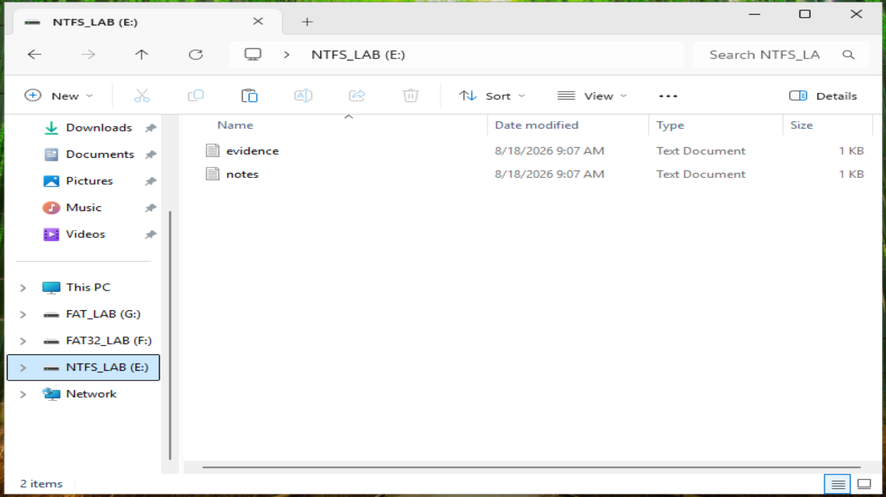
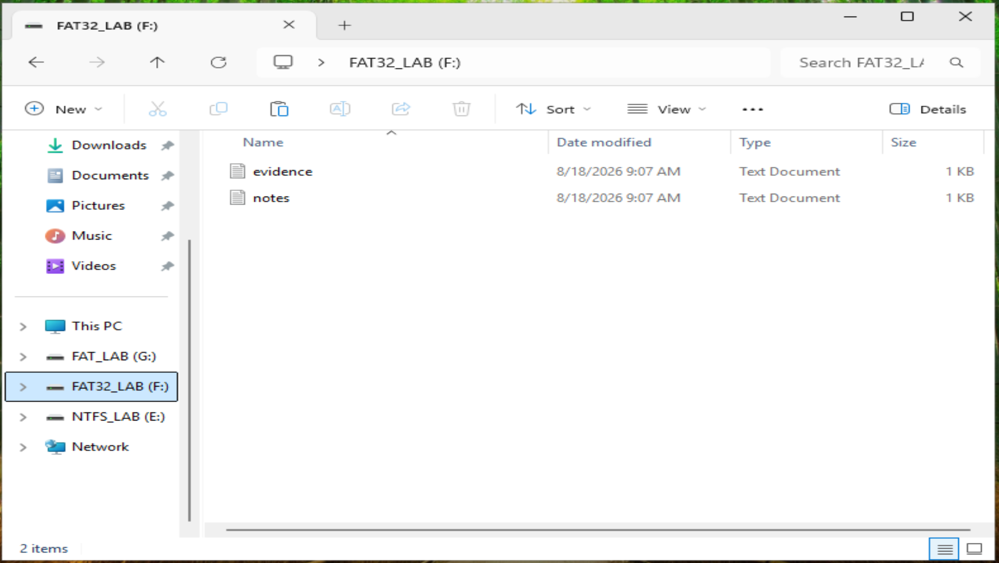
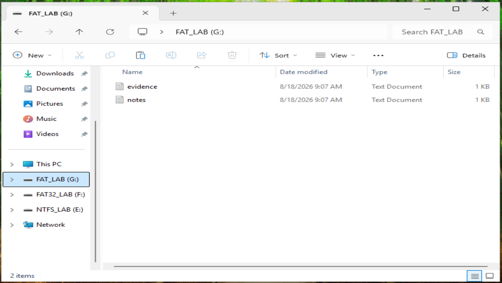

# Controlled File Deletion

## Objective

After creating the controlled evidence files, selected files were intentionally deleted to generate artifacts for forensic examination.

The purpose of this step was to observe how deleted files and their associated metadata appear across NTFS, FAT32, and FAT16 file systems when examined with Exterro FTK Imager.

---

## Evidence Scenario

The test environment contained known text files including:

- `evidence.txt`
- `notes.txt`
- `secret.txt`

The files contained small amounts of recognizable text so that their data could later be identified during forensic examination.

The `secret.txt` file was selected as one of the primary deletion targets.

---

## Controlled Deletion

The file was deleted through the Windows environment rather than securely erased.

This was intentional.

The goal was to generate file-system artifacts that could later be investigated using FTK Imager.

The experiment followed this workflow:

```text
Create Known Evidence
        ↓
Confirm File Exists
        ↓
Delete Selected File
        ↓
Preserve Test Disk
        ↓
Load Physical Disk into FTK Imager
        ↓
Search for Deleted Artifacts
```

---

## Result in Windows

After deletion, Windows File Explorer showed only `evidence` and `notes` on each volume (**2 items**). The `secret` file was no longer visible on NTFS, FAT32 or FAT16.

| Volume | File system | Visible after deletion |
|---|---|---|
| `NTFS_LAB (E:)` | NTFS | `evidence`, `notes` |
| `FAT32_LAB (F:)` | FAT32 | `evidence`, `notes` |
| `FAT_LAB (G:)` | FAT16 | `evidence`, `notes` |







---

## Why This Matters

From the user's point of view, the file is gone. The forensic question is what the file system actually kept. Because the deletion went through Windows (not secure erasure), the later FTK Imager examination found the deleted content preserved in the `$RECYCLE.BIN` folder of every volume.

---

## Next Phase

The three physical drives were loaded into FTK Imager. See [FTK Imager Evidence Loading](03-ftk-imager-evidence-loading.md).
