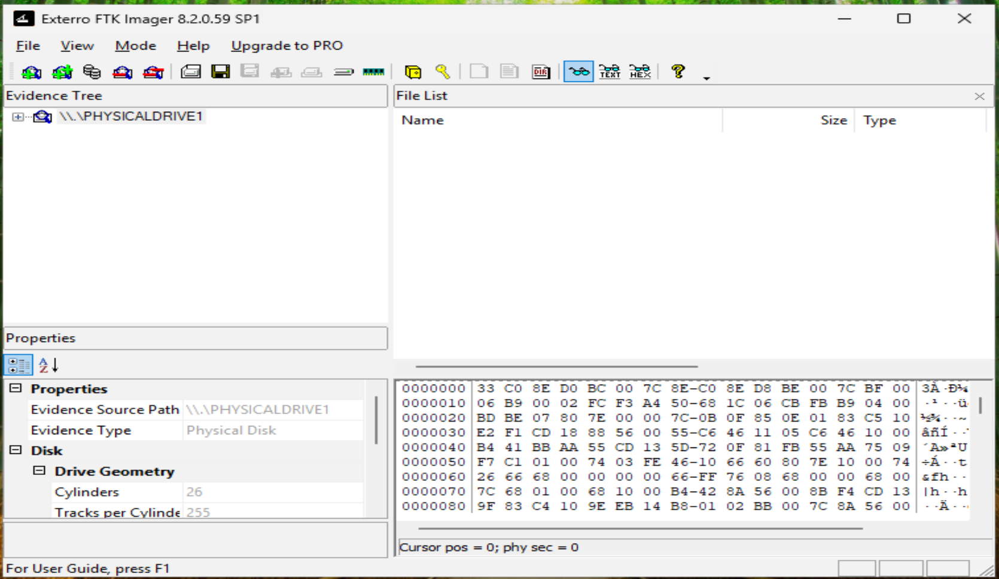
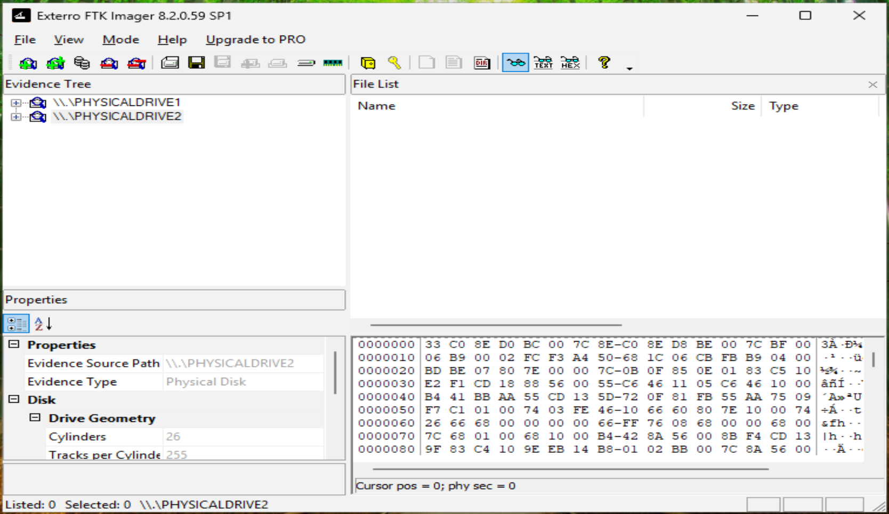
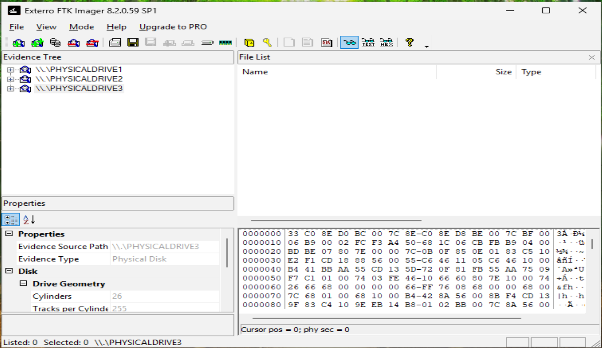

# FTK Imager Evidence Loading

## Objective

The purpose of this phase was to load the controlled laboratory drives into Exterro FTK Imager as physical-drive evidence sources for forensic examination.

The three test volumes contained NTFS, FAT32, and FAT16 file systems. Each volume contained known evidence files and controlled deleted-file artifacts created during the previous phases of the laboratory.

---

## Evidence Sources

The following laboratory volumes were prepared for analysis:

| Volume | File System | Purpose |
|---|---|---|
| `NTFS_LAB` | NTFS | NTFS forensic examination |
| `FAT32_LAB` | FAT32 | FAT32 forensic examination |
| `FAT_LAB` | FAT16 | FAT16 forensic examination |

The drives were added to FTK Imager as physical-drive evidence sources rather than examining only individual files.

---

## Loading Evidence into FTK Imager

Exterro FTK Imager was launched and the **Add Evidence Item** function was used to add each laboratory drive.

The evidence-source type was configured as:

`Physical Drive`

The appropriate physical disk was selected for each laboratory volume.

After loading, FTK Imager displayed the physical drives and their corresponding partitions in the Evidence Tree.

The examination used **Exterro FTK Imager 8.2.0.59 SP1**. Each drive appeared with Evidence Type `Physical Disk`:

| Evidence source | Volume | File system |
|---|---|---|
| `\\.\PHYSICALDRIVE1` | `NTFS_LAB` | NTFS |
| `\\.\PHYSICALDRIVE2` | `FAT32_LAB` | FAT32 |
| `\\.\PHYSICALDRIVE3` | `FAT_LAB` | FAT16 |

---

## Forensic Examination Capability

Loading the complete physical drives allowed FTK Imager to examine information beyond what is normally visible through Windows File Explorer.

The examination included:

- File-system structures
- Active files
- Deleted-file artifacts
- File metadata
- Recycle Bin artifacts where applicable
- Hexadecimal data
- Unallocated space

This approach allowed the laboratory to examine how similar file operations were represented differently by NTFS, FAT32, and FAT16.

---

## Evidence Integrity

The laboratory drives were used as controlled forensic test media. Known files were created before examination, and selected files were intentionally deleted to generate predictable artifacts.

This provided a known baseline for comparing the results observed in FTK Imager.

---

## Next Phase

After the evidence sources were successfully loaded into FTK Imager, each file system was examined separately:

1. NTFS forensic analysis
2. FAT32 forensic analysis
3. FAT16 forensic analysis
4. Cross-file-system comparison
