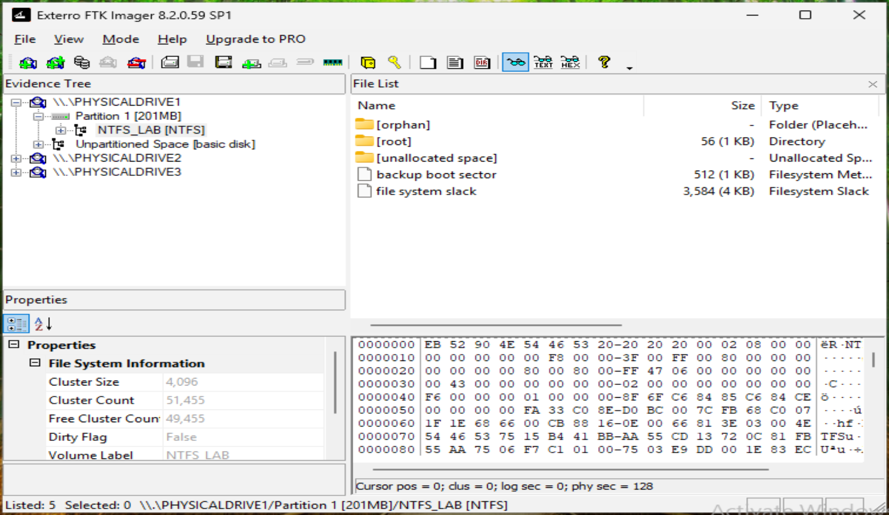
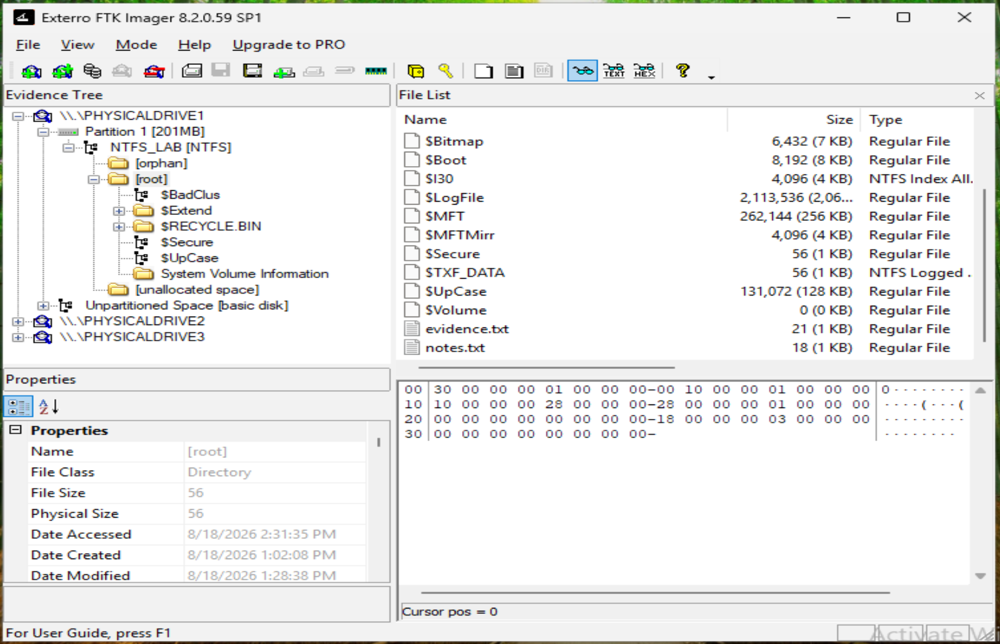
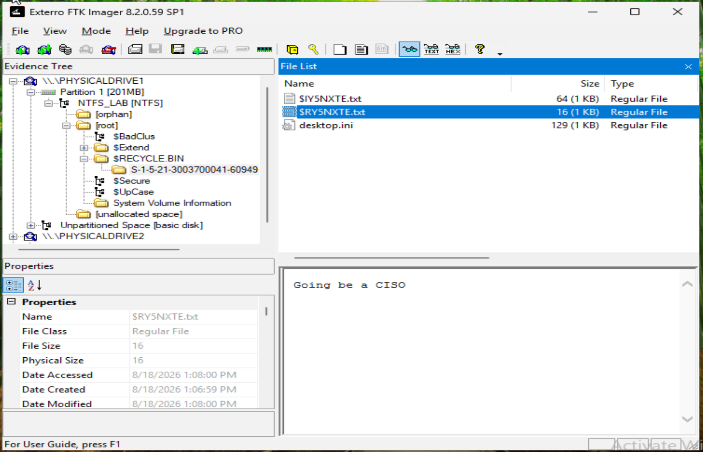
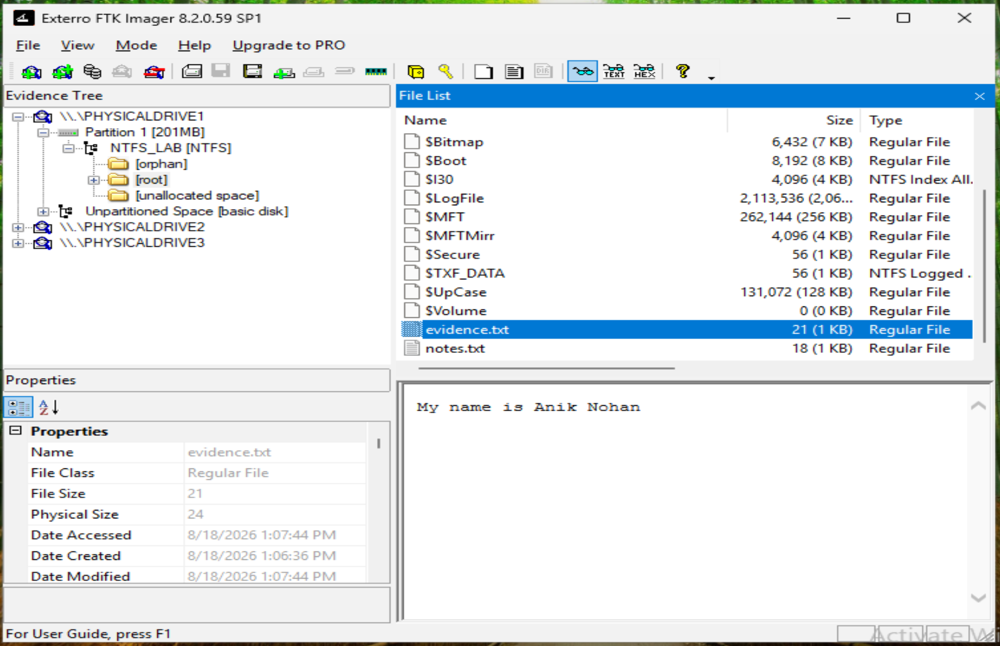
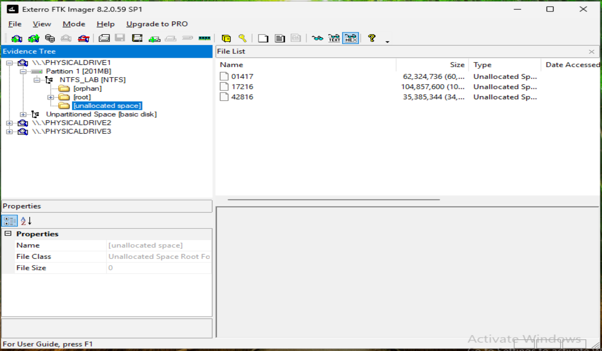
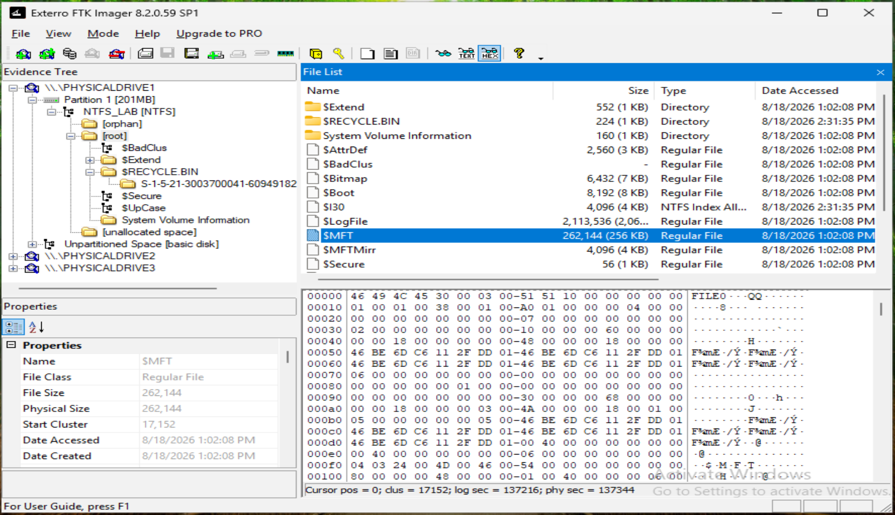
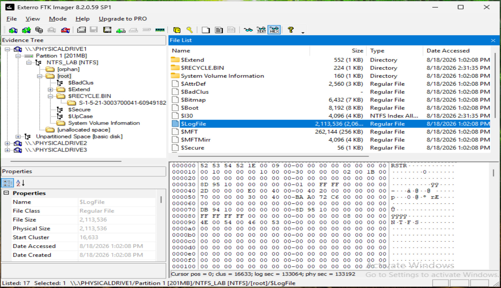
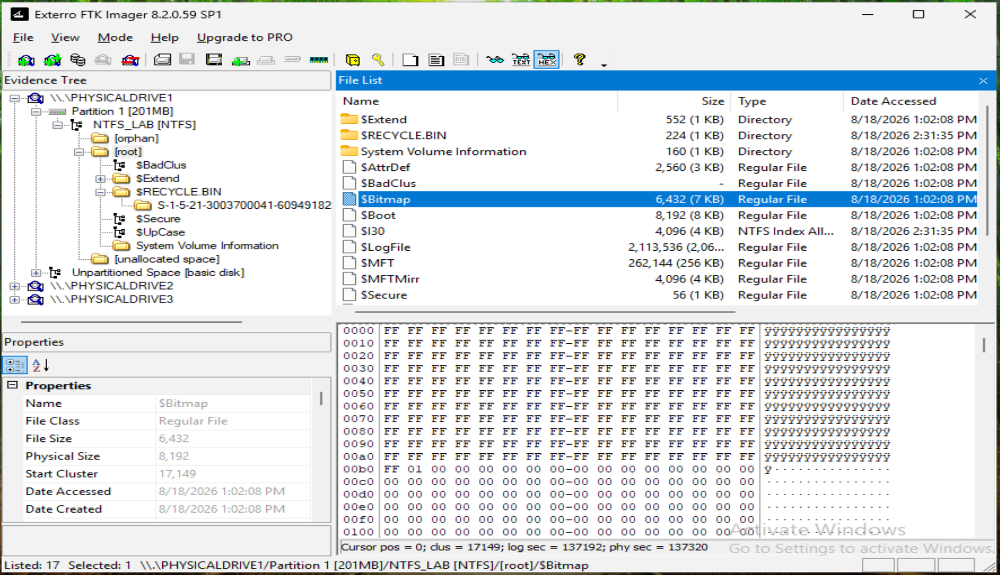

# NTFS Forensic Analysis

## Objective

The first file system examined in Exterro FTK Imager was the NTFS test volume.

The purpose of this phase was to examine the NTFS file-system structure and identify forensic artifacts associated with the controlled file-deletion activity.

---

## NTFS Evidence Source

FTK Imager identified the NTFS test disk as:

```text
\\.\PHYSICALDRIVE1
└── Partition 1 [201MB]
    └── NTFS_LAB [NTFS]
```

---

## NTFS File-System Overview

FTK Imager reported the following file-system information for `NTFS_LAB`:

| Property | Value |
|---|---|
| Cluster size | 4,096 bytes |
| Cluster count | 51,455 |
| Free cluster count | 49,455 |
| Dirty flag | False |
| Volume label | `NTFS_LAB` |

The volume contained `[orphan]`, `[root]` and `[unallocated space]` folders, plus a 512-byte backup boot sector and 3,584 bytes of file-system slack. The boot sector hex begins with the `NTFS` OEM identifier.



---

## Root Directory and Active Files

The root directory contained the NTFS system metadata files (`$MFT`, `$MFTMirr`, `$LogFile`, `$Bitmap`, `$Boot`, `$Secure`, `$UpCase`, `$Volume`, `$TXF_DATA`, `$I30`) alongside the `$RECYCLE.BIN`, `$Extend` and `System Volume Information` folders.

Only two user files remained active: `evidence.txt` (21 bytes) and `notes.txt` (18 bytes). `secret.txt` no longer appeared in the root directory.



---

## Recycle Bin: Deleted File Recovered

Inside `$RECYCLE.BIN`, under the user's SID folder (`S-1-5-21-3003700041-…`), FTK Imager showed one Recycle Bin pair:

| File | Size | Role |
|---|---:|---|
| `$IY5NXTE.txt` | 64 bytes | Recycle Bin metadata record for the deleted file |
| `$RY5NXTE.txt` | 16 bytes | The deleted file's content |

`$RY5NXTE.txt` contained the text **`Going be a CISO`**, 16 bytes, matching the original `secret.txt` exactly. The deleted file's content was fully preserved.



---

## Active File Content and Metadata

`evidence.txt` displayed its expected content, **`My name is Anik Nohan`**, with a logical size of 21 bytes and a physical size of 24 bytes. A physical size far below the 4,096-byte cluster is consistent with small-file data stored resident inside its `$MFT` record rather than in a separate cluster.

FTK Imager showed the file's timestamps (for example, Date Modified 1:07:44 PM) four hours later than the 9:07 AM shown in Windows File Explorer. This is consistent with NTFS storing timestamps in UTC while Explorer displays local time (UTC−4).



---

## Unallocated Space

FTK Imager identified three regions of unallocated space on the NTFS volume:

| Region | Size |
|---|---:|
| `01417` | 62,324,736 bytes |
| `17216` | 104,857,600 bytes |
| `42816` | 35,385,344 bytes |

Unallocated clusters are where data from deleted files can persist until it is overwritten.



---

## Master File Table (`$MFT`)

`$MFT` was 262,144 bytes, starting at cluster 17,152. The hex view begins with the `FILE0` record signature that marks each MFT entry. The MFT holds a record for every file and directory on the volume, including name, timestamps, size and data location.



---

## Transaction Log (`$LogFile`)

`$LogFile` was 2,113,536 bytes, starting at cluster 16,633. Its hex view begins with the `RSTR` restart-area signature. `$LogFile` records metadata changes so the file system can recover after an interruption.



---

## Cluster Allocation Bitmap (`$Bitmap`)

`$Bitmap` was 6,432 bytes, starting at cluster 17,149. Each bit tracks whether a cluster is allocated. The hex view shows runs of `FF` (allocated clusters) followed by `00` (free clusters).



---

## Key Findings

- `NTFS_LAB` was identified on `\\.\PHYSICALDRIVE1` with 4,096-byte clusters.
- The deleted `secret.txt` was fully recovered from `$RECYCLE.BIN` as `$RY5NXTE.txt` (`Going be a CISO`, 16 bytes), with its `$IY5NXTE.txt` metadata record.
- Active files and their content were confirmed (`evidence.txt`: `My name is Anik Nohan`).
- NTFS system metadata (`$MFT`, `$LogFile`, `$Bitmap`) was located and inspected at hex level.
- Three regions of unallocated space were identified.
- NTFS timestamps appeared in UTC, four hours ahead of Explorer's local time.

Next: [FAT32 Forensic Analysis](05-fat32-forensic-analysis.md).
