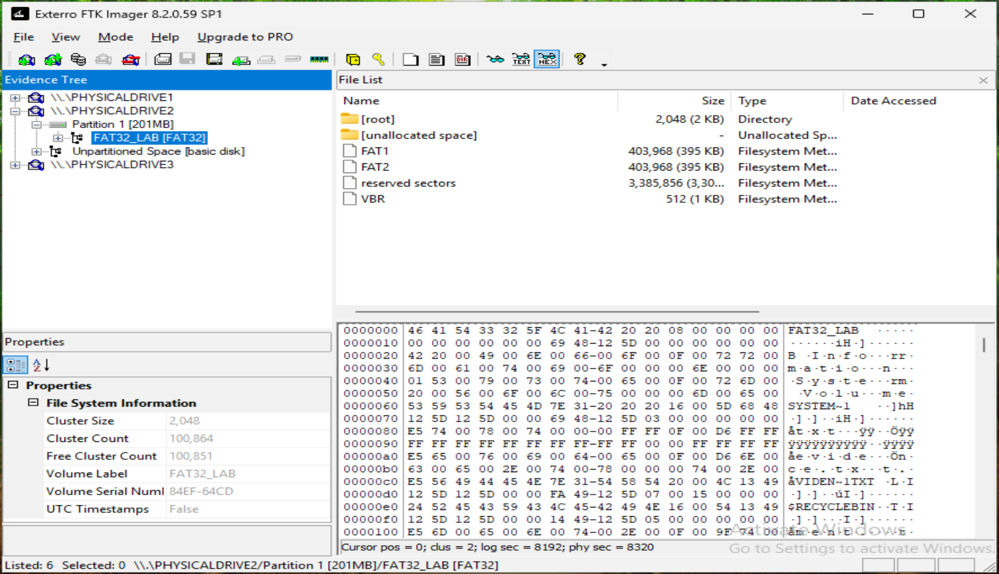
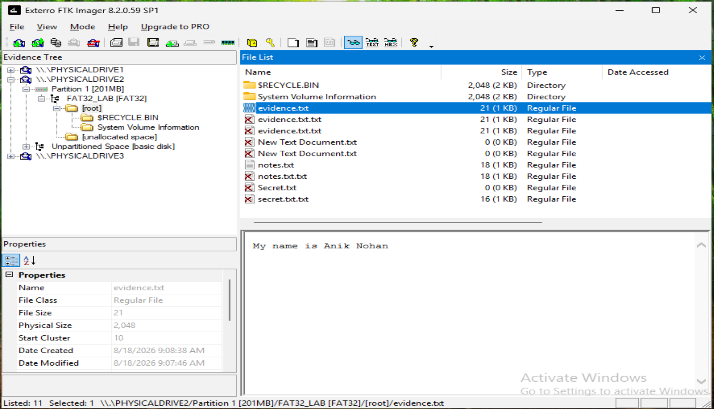
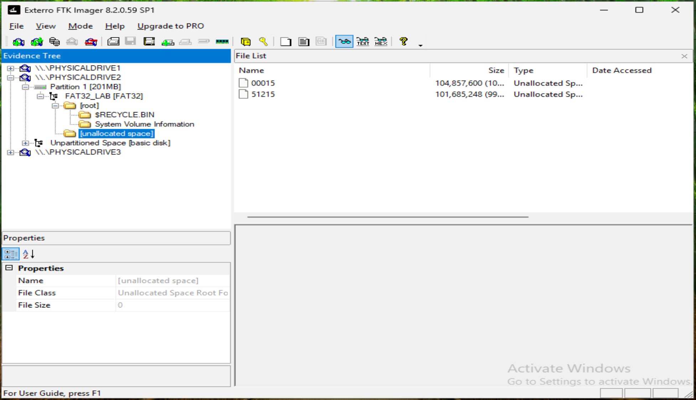

# FAT32 Forensic Analysis

## Objective

The second file system examined in Exterro FTK Imager was the FAT32 test volume.

The purpose of this phase was to examine the FAT32 file-system structure, identify active and deleted file artifacts, inspect recoverable file content and metadata, and review unallocated space for residual data.

---

## FAT32 Evidence Source

FTK Imager identified the FAT32 test disk as:

```text
\\.\PHYSICALDRIVE2
└── Partition 1 [201MB]
    └── FAT32_LAB [FAT32]
```

---

## FAT32 File-System Overview

FTK Imager reported the following file-system information for `FAT32_LAB`:

| Property | Value |
|---|---|
| Cluster size | 2,048 bytes |
| Cluster count | 100,864 |
| Free cluster count | 100,851 |
| Volume label | `FAT32_LAB` |
| Volume serial number | `84EF-64CD` |
| UTC timestamps | False |

The volume structure consisted of `[root]`, `[unallocated space]`, two copies of the File Allocation Table (`FAT1` and `FAT2`, 403,968 bytes each), reserved sectors and the 512-byte volume boot record (`VBR`). This is a much simpler layout than NTFS, with no MFT, transaction log or allocation bitmap.



---

## Root Directory: Active and Deleted Entries

The root directory contained two active user files, `evidence.txt` (21 bytes) and `notes.txt` (18 bytes), plus `$RECYCLE.BIN` and `System Volume Information`.

FTK Imager also listed deleted directory entries, marked with a red **X**: `Secret.txt` (0 bytes), `secret.txt.txt` (16 bytes), `evidence.txt.txt` (21 bytes, two entries), `notes.txt.txt` (18 bytes) and `New Text Document.txt` (0 bytes, two entries). These are leftover entries from earlier names and copies of the lab files.

In the hex view, several directory entries begin with byte `E5`. FAT marks a directory entry as deleted by overwriting the first byte of its name with `0xE5`; the rest of the entry, including size and starting cluster, stays in place.


---

## Recycle Bin: Deleted File Recovered

`$RECYCLE.BIN` on the FAT32 volume held **four** Recycle Bin pairs (`$I` metadata files and matching `$R` content files) plus `desktop.ini`:

| `$I` metadata | Size | `$R` content | Size |
|---|---:|---|---:|
| `$IN2Z9TH.TXT` | 56 | `$RN2Z9TH.TXT` | 0 |
| `$IPI0LC4.TXT` | 64 | `$RPI0LC4.TXT` | 16 |
| `$IPN623X.TXT` | 78 | `$RPN623X.TXT` | 0 |
| `$IV6QR20.TXT` | 68 | `$RV6QR20.TXT` | 21 |

`$RPI0LC4.TXT` contained **`Going be a CISO`**, 16 bytes, the same content as the original `secret.txt`. It occupied a full 2,048-byte cluster (start cluster 12).


---

## Active File Content and Metadata

`evidence.txt` contained **`My name is Anik Nohan`** (21 bytes). Its physical size was 2,048 bytes (one full cluster, start cluster 10), so the remaining 2,027 bytes of that cluster are file slack.

Its Date Modified was 9:07:46 AM, matching the local time shown in Explorer. Unlike NTFS, FAT stores timestamps in local time, which FTK Imager reports as `UTC Timestamps: False`.



---

## Unallocated Space

FTK Imager identified two regions of unallocated space:

| Region | Size |
|---|---:|
| `00015` | 104,857,600 bytes |
| `51215` | 101,685,248 bytes |



---

## Key Findings

- `FAT32_LAB` was identified on `\\.\PHYSICALDRIVE2` with 2,048-byte clusters and a simple FAT1/FAT2/VBR structure.
- Deleted directory entries remained visible, marked with `0xE5` in the hex view.
- The deleted `secret.txt` content (`Going be a CISO`) was recovered from `$RECYCLE.BIN` as `$RPI0LC4.TXT`. Four `$I`/`$R` pairs were present.
- Active files filled whole 2,048-byte clusters, leaving file slack.
- FAT timestamps were stored in local time.
- Two regions of unallocated space were identified.

Next: [FAT16 Forensic Analysis](06-fat16-forensic-analysis.md).
