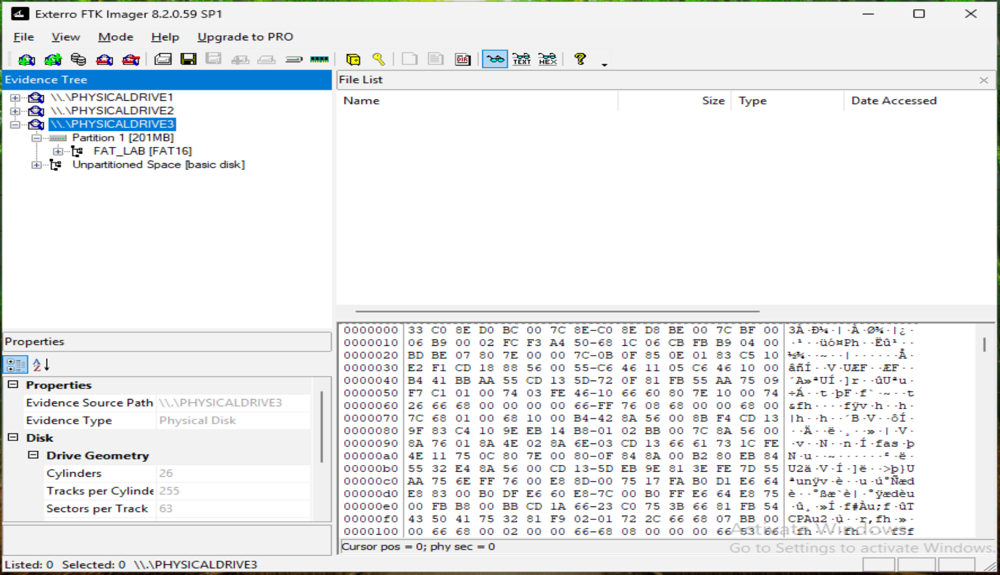
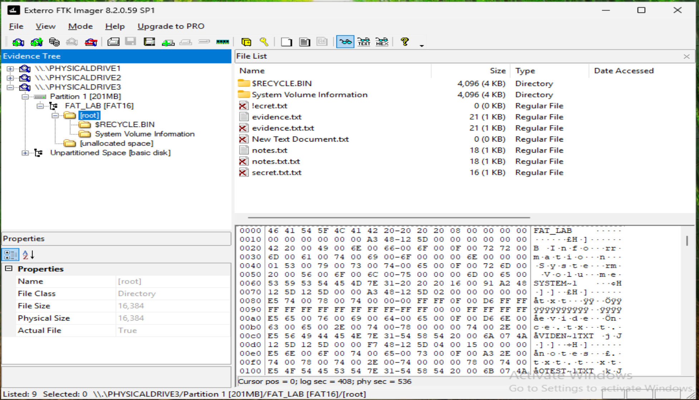
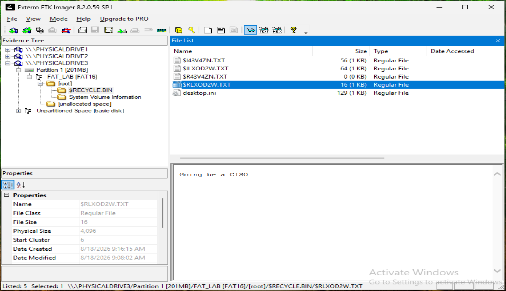
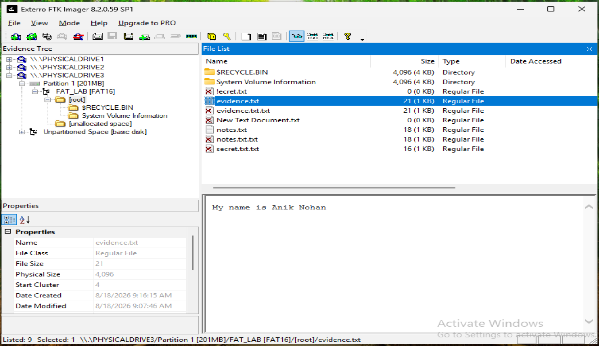
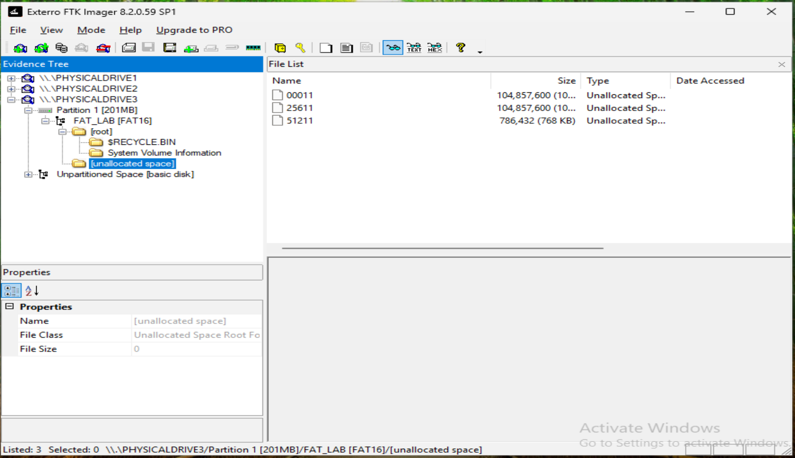

# FAT16 Forensic Analysis

## Objective

The third file system examined in Exterro FTK Imager was the FAT16 test volume.

The purpose of this phase was to examine the FAT16 file-system structure, identify active and deleted file artifacts, recover deleted content, and review unallocated space, completing the comparison with NTFS and FAT32.

---

## FAT16 Evidence Source

FTK Imager identified the FAT16 test disk as:

```text
\\.\PHYSICALDRIVE3
└── Partition 1 [201MB]
    └── FAT_LAB [FAT16]
```

---

## FAT16 File-System Examination

FTK Imager identified the volume as `FAT_LAB [FAT16]` and reported:

| Property | Value |
|---|---|
| Cluster size | 4,096 bytes |
| Cluster count | 51,401 |
| Free cluster count | 51,392 |
| Volume label | `FAT_LAB` |
| Volume serial number | `6030-13E7` |
| UTC timestamps | False |

The file system contained the root directory (16,384 bytes), `FAT1` and `FAT2` (102,912 bytes each), reserved sectors, the 512-byte `VBR`, and unallocated space.



---

## Root Directory Examination

The FAT16 root directory contained two active files, `evidence.txt` (21 bytes) and `notes.txt` (18 bytes), together with `$RECYCLE.BIN` and `System Volume Information`.

Deleted entries were identified by the red X indicators displayed by FTK Imager: `!ecret.txt` (0 bytes), `secret.txt.txt` (16 bytes), `evidence.txt.txt` (21 bytes), `notes.txt.txt` (18 bytes) and `New Text Document.txt` (0 bytes).

The entry shown as **`!ecret.txt`** shows a classic FAT deletion artifact. When FAT deletes a file, it overwrites the first byte of the directory entry's name with `0xE5`, so the original first character is lost. FTK Imager displays a placeholder in its place. The hex view shows the `E5` marker at the start of several entries.



---

## Deleted File Recovery

`$RECYCLE.BIN` on the FAT16 volume held **two** Recycle Bin pairs plus `desktop.ini`:

| `$I` metadata | Size | `$R` content | Size |
|---|---:|---|---:|
| `$I43V4ZN.TXT` | 56 | `$R43V4ZN.TXT` | 0 |
| `$ILXOD2W.TXT` | 64 | `$RLXOD2W.TXT` | 16 |

`$RLXOD2W.TXT` contained **`Going be a CISO`**, 16 bytes, the same content as the original `secret.txt`. It occupied a full 4,096-byte cluster (start cluster 6).



---

## Active File Content

An active file named `evidence.txt` was examined. FTK Imager displayed its content, **`My name is Anik Nohan`** (21 bytes), with a physical size of 4,096 bytes (start cluster 4). The 21-byte file occupied a whole 4,096-byte cluster, leaving 4,075 bytes of file slack. Its Date Modified (9:07:46 AM) matched local time, as on FAT32.



---

## Unallocated Space

FTK Imager identified three regions of unallocated space within the FAT16 volume. These areas may contain residual data from previously deleted files.

| Region | Size |
|---|---:|
| `00011` | 104,857,600 bytes |
| `25611` | 104,857,600 bytes |
| `51211` | 786,432 bytes |



---

## Key Findings

The FAT16 examination demonstrated:

- Identification of the FAT16 file-system structure on `\\.\PHYSICALDRIVE3`, with 4,096-byte clusters.
- Examination of active and deleted files.
- The `0xE5` deletion marker, which caused the deleted entry to appear as `!ecret.txt`.
- Recovery of the deleted `secret.txt` content (`Going be a CISO`) from `$RECYCLE.BIN` as `$RLXOD2W.TXT`.
- Review of file metadata, local-time timestamps and file slack.
- Identification of three unallocated-space regions.

These findings show how FTK Imager can be used to examine FAT16 file-system artifacts and recover evidence from deleted files.

Next: [File-System Forensic Comparison](07-file-system-forensic-comparison.md).
